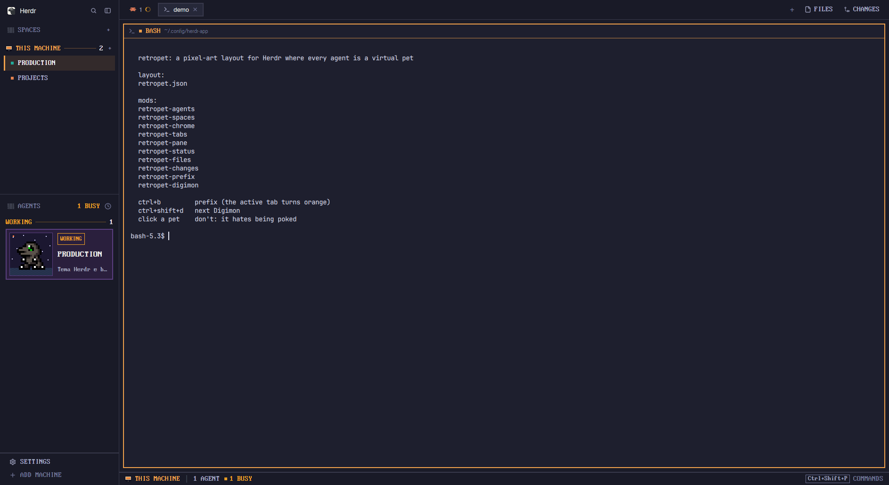
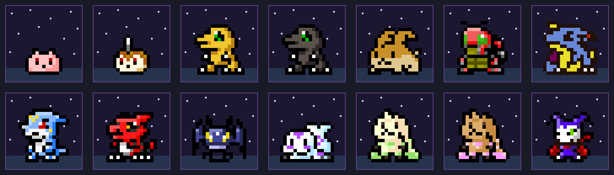

# RetroPet

Layout para o [Herdr](https://herdr.dev) desktop: barra lateral, abas e molduras em pixel art, e cada agente vira um bichinho virtual. Um Digimon que dorme quando o agente está parado, pula quando ele trabalha e chama você quando precisa de resposta.

*A pixel-art layout for the Herdr desktop app where every agent is a virtual pet: a Digimon that sleeps while the agent is idle, hops while it works and calls you when it needs an answer. See [RECIPE.md](RECIPE.md).*





## Instalar

```sh
git clone https://github.com/higorhgon/retropet
cd retropet
cp layouts/retropet.json layouts/retropet.png ~/.config/herdr-app/layouts/
cp themes/retropet.json ~/.config/herdr-app/themes/
cp -r mods/* ~/.config/herdr-app/mods/
herdr-app do layout.switch '{"name":"retropet"}'
```

Depois junte o `keys.json` daqui ao seu `~/.config/herdr-app/keys.json` (as chaves de `global` e a seção `mod:retropet-prefix`). Sem isso o layout funciona, mas sem o prefix e sem a troca de Digimon.

`Ctrl+Shift+L` alterna entre os layouts; para remover, apague os arquivos copiados.

## O que faz

- **Agentes como bichinhos.** 14 Digimons (Koromon, Tsunomon, Agumon, Agumon Black, Patamon, Tentomon, Gabumon, Veemon, Guilmon, Pico Devimon, Gomamon, Terriermon, Lopmon, Impmon), um por agente, sorteado pelo endereço.
  - trabalhando: pula entre duas posições, como num V-pet;
  - parado: dorme (com um "z" no canto);
  - precisa de você: alterna com a pose de ataque;
  - clique no Digimon: ele pula na pose do quadro 3 por 3 segundos.
- `Ctrl+Shift+D` troca o Digimon do agente em foco.
- **Prefix estilo tmux:** `Ctrl+B` (ou `Ctrl+Space`) arma o prefix e a aba atual fica com contorno laranja; a tecla seguinte roda um comando de `mods/retropet-prefix/bindings.json` (`v`/`h` dividem, `c` nova aba, `b` recolhe a barra lateral, `f` Files, `Shift+G` Changes, `?` atalhos...).
- Barra lateral, abas, molduras dos terminais, painéis Files/Changes e barra de status em pixel art, com fonte VGA.

Os mods não acessam a rede. `retropet-spaces` roda `git` e `hc machine` (como o mod original do Herdr), e `retropet-prefix` usa `hc keys` para mandar o próprio prefix ao terminal.

## Créditos

Construído sobre [herdr-pixel-layout](https://github.com/murtuzaalisurti/herdr-pixel-layout) e [herdr-retro](https://github.com/MarlonAzevedo/herdr-retro), com sprites de [wayland-vpets](https://github.com/furudbat/wayland-vpets). Digimon é marca da Bandai, Akiyoshi Hongo e Toei Animation; projeto gratuito e sem fins comerciais. Licenças e detalhes em [NOTICE](NOTICE).
