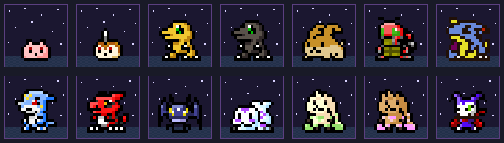

# RetroPet

A pixel-art take on Herdr's main window where every agent is a virtual pet. The sidebar, tabs, terminal frames, side panels and status line are square, pixel-type and navy, after herdr-pixel-layout. Each agent card shows a Digimon on a starry sky: it sleeps while the agent is idle, hops in two steps while it works, flashes its attack pose while the agent needs the person, and jumps when clicked. A tmux-style prefix key outlines the active tab in orange while armed.

## What you see

Left to right, the regions of Herdr's `main` layout.

**Sidebar** (268px, `chrome`, folds to a 44px rail):

1. **Brand bar** (46px): Herdr's `workspace-chrome`, unchanged.
2. **Spaces** (`retropet-spaces`, weight 2, min 90px), herdr-pixel-layout's:
   - header: a 14×12 dithered square (`#5a5f6e` checkerboard), `SPACES` in PxPlus IBM VGA 8x16 at 16px, `dim`, and a pixel `+`;
   - one heading per machine: a pixel monitor or server icon, the name in upper case (`THIS MACHINE` for this computer) in `#f0a04b`, a 1px `#f0a04b66` rule, the space count and a `+`; unreachable machines in `dim` with their state (`needs login`, `unreachable`);
   - space rows (32px): a 6×6 square in the space's color, the name in VGA 16px; the active row has a 3px `#f0a04b` left bar and a `#f0a04b1f` fill. The branch and ahead/behind sit on the right in VGA 14px, `dim`. `New space there` and `Loading…` are VGA 14px too.
3. **Agents** (`retropet-agents`, weight 3), herdr-pixel-layout's list:
   - header: the dithered square, `AGENTS`, `N BUSY` (`working` color when N > 0), the sort icon;
   - group headings by status (Working, Idle, Done, Needs you) or by space;
   - one **Digimon card** per agent: 2px border, 6px padding, 10px gap, fill and border per machine (this computer `#2a1f3d`/`#5b3f80`, then `#1f2438`/`#3b4466`, `#1b2e33`/`#2f5a5e`, `#2d2238`/`#5e4a7a`), `#f5a524` border when focused.
     - Left: a 92×92 box (1px machine border) with the scene `scene.svg`: a 45×45 grid of 2px pixels, sky `#1b1730` with ten `#d8d2ff` stars and an 8-row floor of diagonal 2px stripes in `#2a3550` / `#22304a`. The Digimon stands on the floor, bottom-aligned 8px up. A 3px machine-color dot sits top-left; idle adds a boxed `z` top-right; a pinned agent shows a pin bottom-right.
     - Right: the status badge (`WORKING`, `NEEDS YOU`, `DONE`, `IDLE`) in VGA 13px with a 1px border in the status color (idle in `muted`), the space name in VGA 19px bold, and the tab's title or the program in VGA 14px, `muted`.
4. **Footer** (69px, `retropet-chrome` `{footer: true}`): `SETTINGS` and `ADD MACHINE` in VGA 16px with pixel icons; hover gives a 3px `#f0a04b` left bar.

**Tab bar** (42px, `retropet-tabs`): square tabs (no rounding) with a 2px border, the active one `raised` with a `border` outline. `FILES` and `CHANGES` on the right in VGA 16px, upper case, with an orange 2px outline and `#f0a04b1f` fill when that panel is open.

**Panes**: 2px `border` frame, 2px `#f0a04b` when focused, radius 0, 8px gap, lone panes framed. Header (30px, `retropet-pane`): program name in VGA upper case, folder, status badge; split/zoom/close on hover.

**Side panel**: `retropet-files` and `retropet-changes`, Herdr's Files and Changes with every rounded corner removed and a 2px border.

**Status bar** (28px, `retropet-status`): pixel monitor icon and `THIS MACHINE` in `#f0a04b`, `│`, branch, `│`, `N AGENTS`, a 6×6 square and count per status (the busy one blinks), and on the right the palette key in a 1px keycap (VGA 14px when plain ASCII) and `COMMANDS`.

Theme `retropet` (layout-owned): terminal background `#1e1f2e`, foreground `#d4d6e8`, canvas `#1a1b28`, chrome `#191a27`, border `#2c2f47`, accent `#8fa6e6`.

## How it behaves

- **Each agent's Digimon**: `digimon.js` lists 14 Digimon with four frames each: `rows` (idle, frame 0), `sleep` (frame 6), `call` (the last frame, the attack) and `poke` (frame 2). An agent gets `DIGIMON[(hash(address) + step) % 14]`, where `step` is shared `"retropet.digimon"[address]`; `Ctrl+Shift+D` (`retropet-digimon`) adds 1 for the focused agent.
- **Status → pose**:
  - `working`: the idle frame swaps between its spot and one sprite pixel higher, every 500ms, with no glide;
  - `idle`: the sleep frame, still;
  - `blocked`: idle and call frames swap every 500ms, bottom-aligned;
  - `done`: the idle frame, still.
- **Click the Digimon**: for 3s it hops in its poke frame, then goes back to its state's pose. A click elsewhere on the card focuses the agent's pane; right-click pins or unpins it.
- **Size**: one sprite pixel is the entry's `px` if set (Koromon, Tsunomon 4.5; Terriermon, Lopmon 3.6), else 4px if any frame is wider or taller than 12 pixels, else 5px. The same in every frame.
- **Prefix**: `Ctrl+B` / `Ctrl+Space` open `retropet-prefix`, an invisible 1×1 popup that sets shared `"prefix.armed"`; `retropet-tabs` then draws the active tab with a 2px `#f0a04b` outline and `#f0a04b1f` fill. The next key runs its action from `bindings.json` (same format as `keys.json`) and disarms; the prefix again sends it to the terminal (`hc keys`); Esc or an unknown key cancels. `b` runs `retropet-sidebar-fold` (rail ↔ last width), `f` and `Shift+G` toggle the Files and Changes panels.
- Spaces, sub-agents, sorting, pinning and machine reconnects behave as in Herdr's own mods.

## Built from

- `layouts/retropet.json`: Herdr's `main` tree with `theme: "retropet"`, `preview`, and blocks `spaces` → `retropet-spaces`, `agents` → `retropet-agents`, `sidebar-footer` → `retropet-chrome`, `tabs` → `retropet-tabs`, `files` → `retropet-files`, `changes` → `retropet-changes`, `status` → `retropet-status`; the `main` block's pane frame as above with header `retropet-pane`.
- `retropet-agents`: herdr-pixel-layout's `pixel-agents` with its card replaced. `sprite()` draws a frame as a grid of `div`s; `hop()` and `call()` stack two copies and swing their opacity linearly far past 0..1 (`loop("opacity", {from: 21, to: -20, period: 1000})` and its inverse), so each copy is fully on or off and the switch takes one frame: native, no timer. The poke timeout is one `cx.timer.after(3000)`.
- Sprites: wayland-vpets' `dmall` sheets (13 frames, 11 for some), first idle frame at native size (3px per pixel in the sheets). Patamon is dm20's drawing recolored with dmc's colors (sleep: frame 3; call: dmc's frame 4); Gabumon is dm20's "Yamatos Gabumon" colored region by region (pelt `#6888d8`, body and horn `#e8e028`, eye `#c02000`, stripe `#700058`, claws `#f8f8f8`).
- Fonts: PxPlus IBM VGA 8x16 (`retropet-agents/fonts`), Pixelated MS Sans Serif (`retropet-spaces/fonts`).
- Programs: `git` and `hc machine` in `retropet-spaces`, `hc keys` in `retropet-prefix`. No network.

## Watch out

- A mod can't import another mod's file: `retropet-digimon` only stores a step; `retropet-agents` does the math.
- The fonts load at start and on the next look change: right after copying, switch layouts once.
- Edits to a layout file sometimes need a layout switch before new mod names show.
- The black sprite outline vanishes on a dark box; the scene's navy sky is what makes it read.
- Sheets of 9 frames (dm20, dmc) have no attack frame and sleep in a bed; those are the Patamon and Gabumon special cases.
- `herdr-app shot` returns the last rendered frame; with the window on another workspace it is stale.
- On a shipped layout (Herdr's `main`) the prefix still works but nothing shows it: the tab outline lives in `retropet-tabs`.

## Done when

- `herdr-app check` passes for every folder in `mods/`.
- `layout.switch {"name":"retropet"}` shows SPACES and AGENTS in pixel type, square tabs, square 2px pane frames and the pixel status line.
- Each running agent has a card with a Digimon on the starry floor; a working agent's Digimon hops in two steps; an idle one sleeps.
- `Ctrl+B` outlines the active tab in `#f0a04b`; `b` then folds the sidebar to its rail and again unfolds it.
- `Ctrl+Shift+D` changes the focused agent's Digimon; clicking a Digimon makes it hop in its poke frame for 3 seconds.
